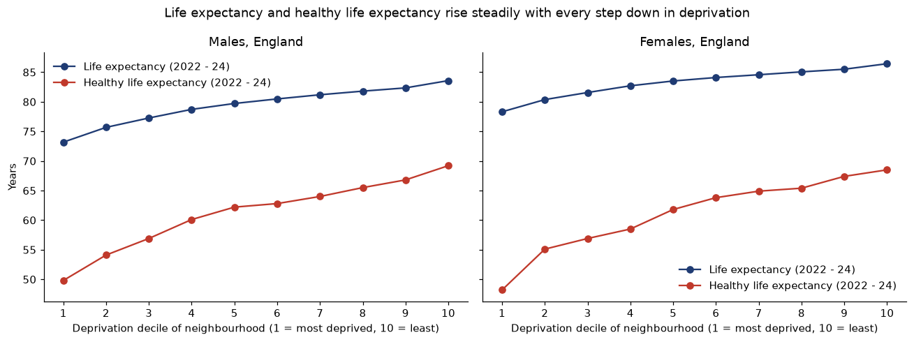
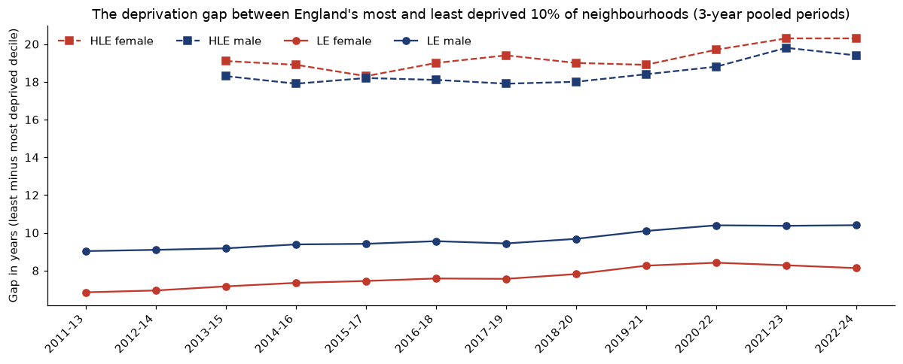
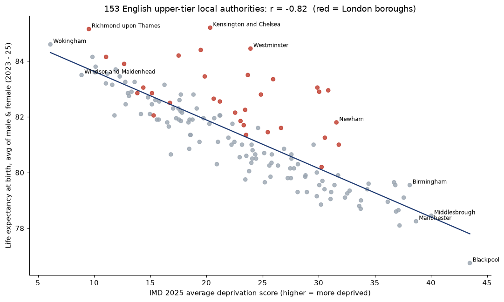
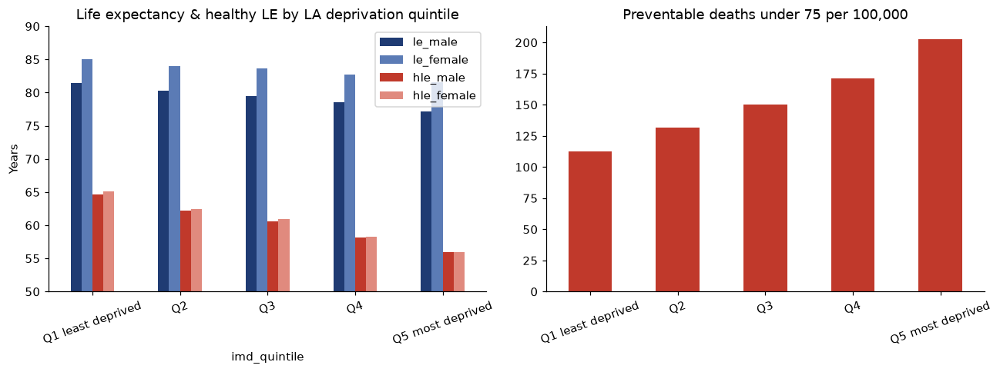
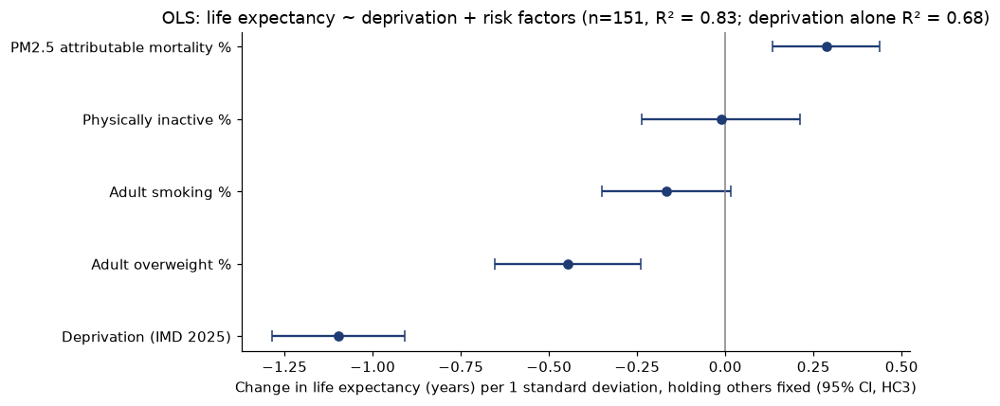
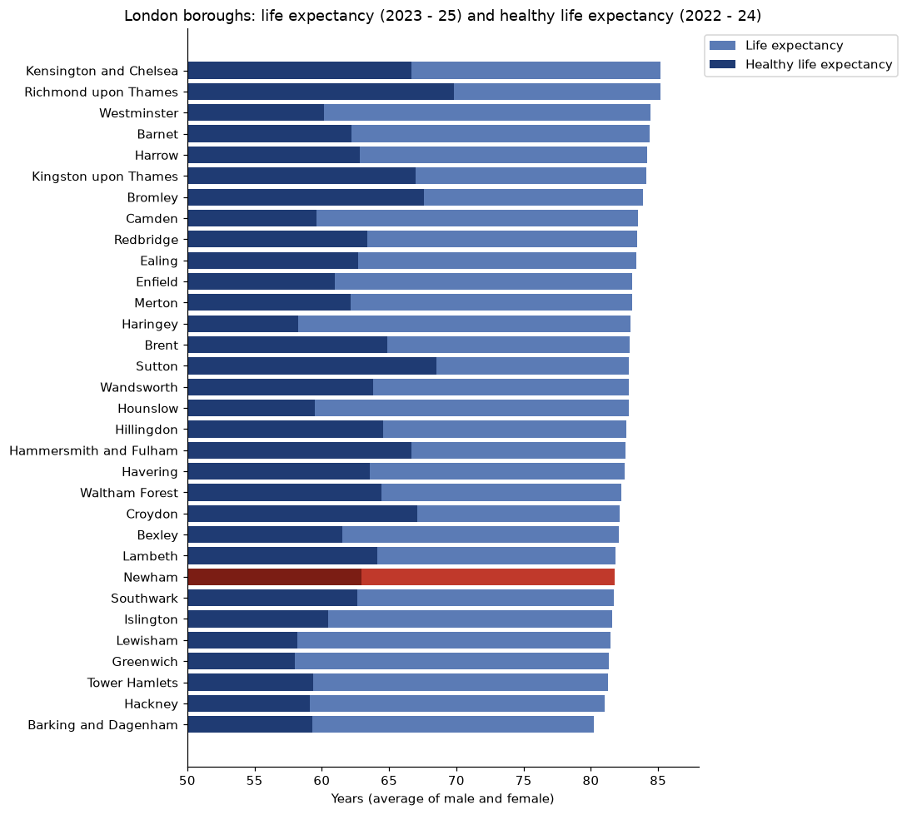
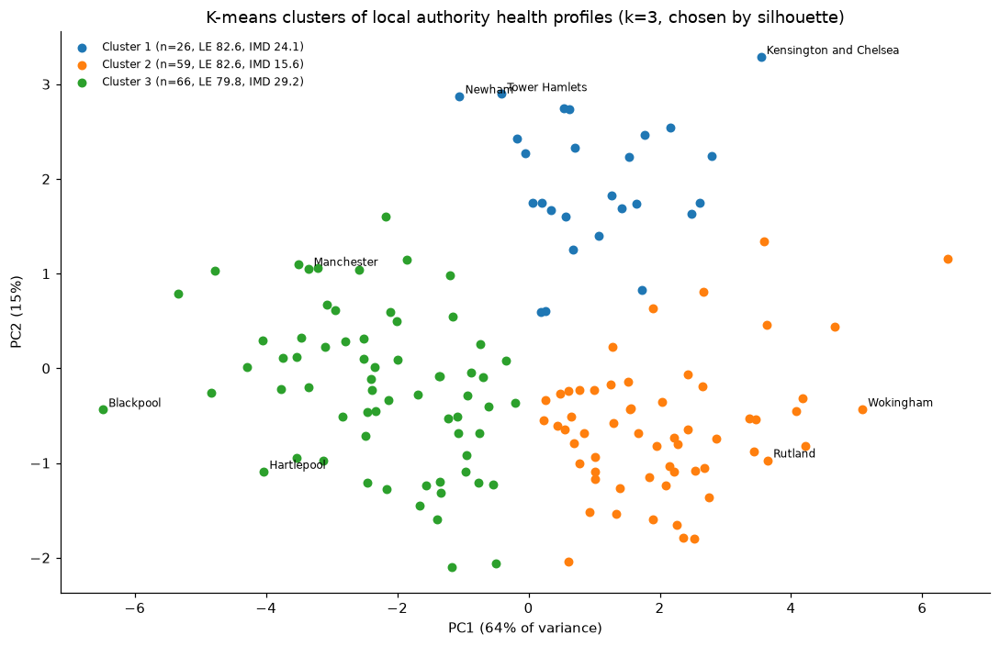
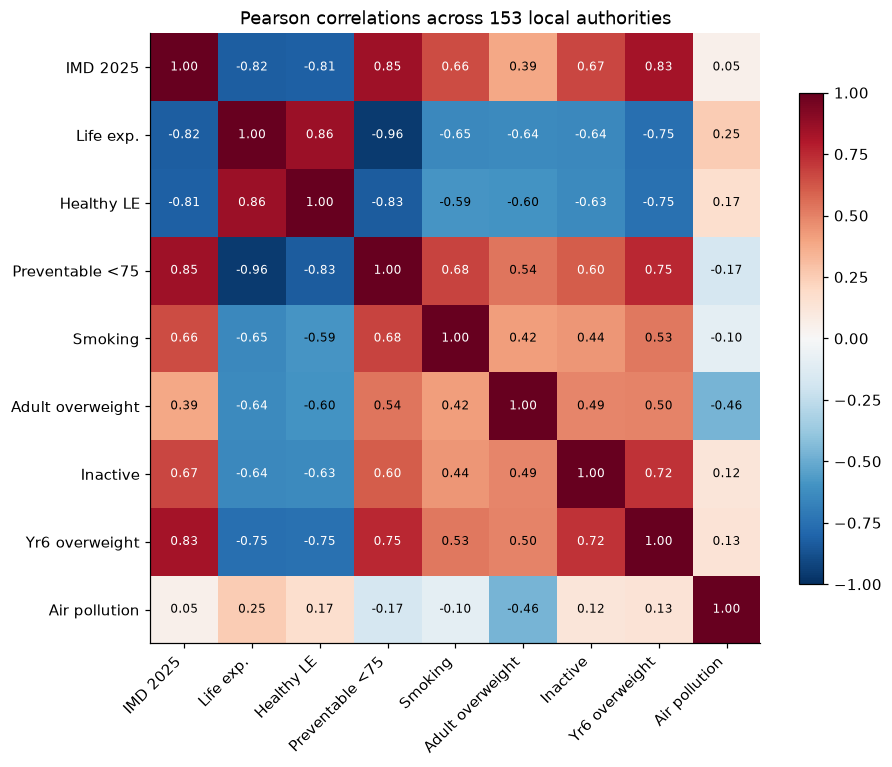
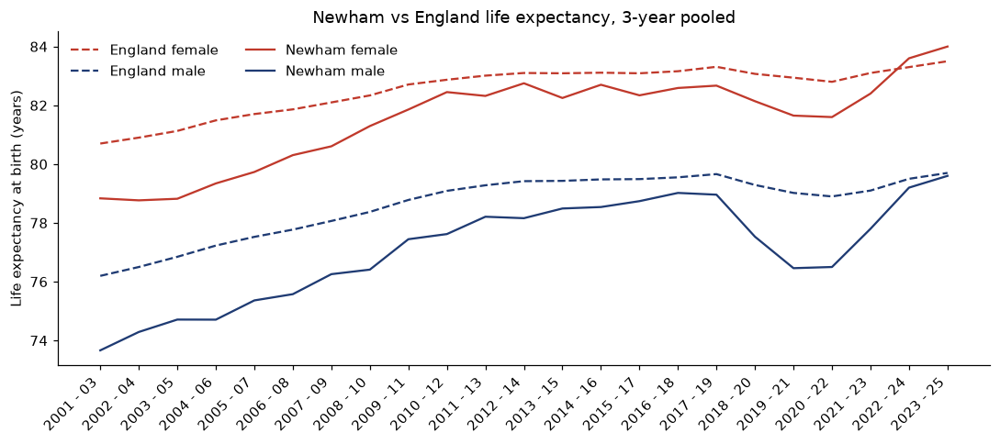

# Health inequalities across English local authorities

How much does where you live in England decide how long, and how long *in good health*, you live?
This project pulls official public health indicators for all 153 upper-tier local authorities from the
**OHID Fingertips API**, measures the gap between the most and least deprived areas, models life
expectancy against deprivation and behavioural risk factors, spotlights London (including Newham) and
clusters areas by their health profile. It finishes with an interactive Streamlit dashboard.

Author: Anthony Adusei-Poku ([@anthony07-max](https://github.com/anthony07-max))



## Key findings

All numbers below come from the latest pipeline run (data downloaded October 2026).

| England, 2022-24 | Most deprived 10% of neighbourhoods | Least deprived 10% | Gap |
|---|---|---|---|
| Life expectancy, males | 73.2 | 83.6 | **10.4 years** |
| Life expectancy, females | 78.3 | 86.4 | **8.1 years** |
| Healthy life expectancy, males | 49.8 | 69.2 | **19.4 years** |
| Healthy life expectancy, females | 48.2 | 68.5 | **20.3 years** |

1. **The healthy-life gap is about twice the life-expectancy gap.** Women in England's most deprived
   neighbourhoods can expect to live in good health until about 48, which is 20 years less than women in the least deprived areas.
2. **The gap has widened.** The male life-expectancy gap grew from 9.0 years (2011-13) to 10.4 years (2022-24), and the female gap grew from 6.8 to 8.1 years
   (its peak was 8.4 in 2020-22, during COVID). The female healthy-life-expectancy gap grew from 19.1 (2013-15) to 20.3 years.
3. **Deprivation alone explains two thirds of the variation between areas.** Across 151 local authorities, the IMD 2025 deprivation score
   correlates at **r = -0.82** with life expectancy (2023-25). Each extra 10 IMD points goes with about **1.7 fewer years** of life.
   Blackpool (most deprived, 76.8 years) and Kensington & Chelsea (85.2) are 8.4 years apart. For healthy life expectancy, Blackpool (51.4)
   and Richmond upon Thames (69.8) are **18.4 years** apart.
4. **Areas in the most deprived fifth have about 1.8 times the preventable death rate** of the least deprived fifth (202.9 against 112.6 deaths under 75
   per 100,000). Their adult smoking rate is 12.4% against 7.0%, and male healthy life expectancy is 56.0 against 64.6 years.
5. **Regression** (OLS with standardised predictors and HC3 robust errors, n = 151): deprivation alone gives R² = 0.68. Adding risk factors raises
   R² to **0.83**. Holding the other factors fixed, 1 SD more deprivation (about 7.9 IMD points) is associated with **-1.10 years**, and 1 SD more adult
   overweight with -0.45 years. Smoking (-0.17, p = 0.07) and inactivity (≈0) add little once deprivation is in the model. PM2.5 has a
   *positive* coefficient (+0.29). This is almost certainly confounding: London has the most air pollution and also the longest lives.
   These are ecological associations between areas, not causal effects on individuals.
6. **London is the exception.** London has the highest average life expectancy of any region (82.8 years across 32 boroughs) even though its average
   deprivation (22.2) is higher than the South East (16.8) or South West (18.0). The North East is lowest (79.7 years, healthy LE 56.5).
7. **Newham** is London's 2nd most deprived borough (IMD 31.6) and ranks 22nd most deprived of 153 areas in England. Its life expectancy is 81.8 years
   (8th lowest in London), but its healthy life expectancy of 63.0 is mid-table in London (15th of 32) and above the England average (60.9 male / 61.3 female).
   Male life expectancy in Newham rose from 73.7 (2001-03) to 79.6 (2023-25), which is level with England's 79.7. It fell to 76.5 in 2019-21 during COVID.
   Female life expectancy (84.0) is now above England's (83.5).
8. **Clustering** (k-means on 9 standardised indicators; k = 3 chosen by silhouette 0.34) finds three health profiles:
   - **London-type** (26 areas, 25 of them London boroughs): life expectancy 82.6 despite above-average deprivation (24.1), with high air pollution.
   - **Affluent shires** (59 areas, IMD 15.6): healthy life expectancy 63.5.
   - **Deprived North and Midlands** (66 areas, IMD 29.2): life expectancy 79.8, healthy life expectancy 57.0 and 189 preventable deaths per 100k.
     Barking & Dagenham is the only London borough in this group.

| | |
|---|---|
|  |  |
|  |  |
|  |  |
|  |  |

## Data sources and licence
All data comes from the **Office for Health Improvement and Disparities (OHID) Fingertips** platform:
[fingertips.phe.org.uk](https://fingertips.phe.org.uk). It is downloaded through the public API
(`/api/all_data/csv/by_indicator_id`) for upper-tier local authorities (post April 2023 boundaries, area type 502) and England.
Fingertips data is published under the [Open Government Licence v3.0](https://www.nationalarchives.gov.uk/doc/open-government-licence/version/3/).
Contains public sector information licensed under the OGL v3.0.

| Indicator (Fingertips ID) | Period used | Original source |
|---|---|---|
| Life expectancy at birth (90366), 3-year pooled | 2023-25 (LAs, provisional); 2022-24 (England deciles) | ONS / OHID |
| Healthy life expectancy at birth (90362) | 2022-24 | ONS / OHID |
| Inequality in life expectancy at birth, slope index (92901) | 2022-24 | OHID |
| Under 75 mortality from preventable causes (93721) | 2024 | OHID, ONS deaths |
| Adult smoking prevalence, 18+ (92443) | 2025 | ONS Annual Population Survey |
| Adult overweight incl. obesity (93088) | 2024/25 | Sport England Active Lives |
| Physically inactive adults (93015) | 2024/25 | Sport England Active Lives |
| Year 6 overweight incl. obesity (20602) | 2024/25 | NHS England NCMP |
| Mortality attributable to PM2.5 (93861) | 2024 | UKHSA |
| Deprivation score, IMD 2025 (94240) | 2025 | MHCLG English Indices of Deprivation 2025 |

## Project structure
```
src/download.py      # calls the Fingertips API, saves raw CSVs + region lookup into data/raw/ (git-ignored)
src/clean.py         # latest value per indicator per LA, England decile series, LA time series -> data/processed/
src/analysis.py      # deprivation gaps, correlations, OLS regression, London/Newham spotlight, k-means + PCA,
                     # SQL (SQLite) regional summary, charts and key_findings.json
app/streamlit_app.py # interactive dashboard (England deciles, scatter explorer, London, clusters, area profile)
charts/              # PNG outputs
data/processed/      # tidy CSVs used by the dashboard (small)
```

## How to run
```bash
python -m venv .venv && source .venv/bin/activate
pip install -r requirements.txt
./run_pipeline.sh                      # download, clean, analyse (about 1 minute)
streamlit run app/streamlit_app.py     # dashboard at http://localhost:8501
```

## Method notes and limitations
- "Most/least deprived decile" in findings 1-2 means England's neighbourhoods (LSOA 2021) grouped into national tenths by IMD. Those figures are
  OHID's own England-level estimates. The local authority figures (findings 3-8) compare whole areas, so the gaps are smaller and diluted.
- Life expectancy and healthy life expectancy are averaged across male and female for single-number comparisons. The separate values are kept in `la_indicators.csv`.
- Life expectancy for 2023-25 is marked provisional by OHID. City of London and Isles of Scilly have no values for several indicators, so they drop out of the models.
- Indicators cover slightly different periods (see table). This is fine for cross-sectional comparison, but they are not a single-year snapshot.
- Regression and correlations are ecological (area level). They describe patterns between places, not causes for individuals.
- Clustering is exploratory. The labels ("London-type", etc.) are my descriptions of the cluster averages.
